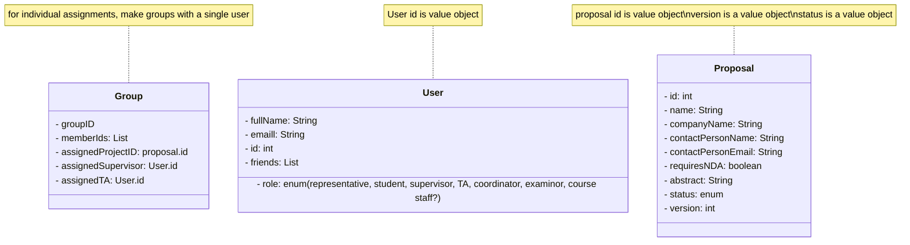

# Architecture design
## Tactical DDD
### A

### B
ProposalVisibilityService
------
+getVisibleProposals(studentId) : List<Proposal>
NOTE: Works out which proposals a student can see across all proposals at once, so it doesn't fit inside one entity.

RegistrationService
------
registerUser(email : Email, name : fullName, role: role)
NOTE: this service handles registration of users and the assiging of their roles. please note that this should be called after verifiying if this person should get this role

ProposalManagementService
------
createProposal(name, contactPersonName, contactPersonEmail, requiresNDA, abstract): void
updateProposal(id, name, contactPersonName, contactPersonEmail, requiresNDA, abstract): void
acceptProposal(id, version)
NOTE: "to update a proposal the UI should fetch the current info and the submit the edited info to the proposalManager, manager should increment version, ID should be the same for all version of a proposal. then set status to pending"

friendMatchingService
-----
findOptimalMatches(): void
NOTE: "uses external algorithm to match students with friends listed in the friends field. result should be displayed externally"

### C
_ user _
user 'manages' (agrate) the user ID

_ proposal - 
the proposal class manages the proposal ID's that are handed out

_ proposalManagemntService _
the management service takes care of the issueing of ID's to proposals and updating the version when an update occurs. it also sets the statuses of proposals

## 2
Clearly the rendering of the conversation should be split into it's own class or abstract class.
That way it can be reused for both the group and direct messaging systems, reducing code duplication.
The video class stores the videoFormat despite this being the same everytime, this should be a constant.
The text class is completly redundant. You might even consider an abstract class or an interface instead for the Message class.
By implementing a rendering method for each message you can remove the renderMessage method, instead calling the method that's attached to each instance of a subclass of Message seperatatly.
This way you can forgo the switch case and also the entire method, AND it is also more pragmatic since the renderText/renderGIF/etc methods should be static and not attached to the conversation class

